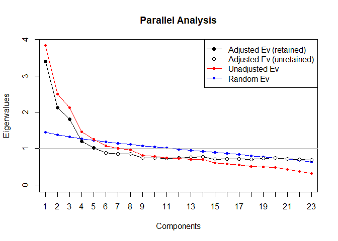
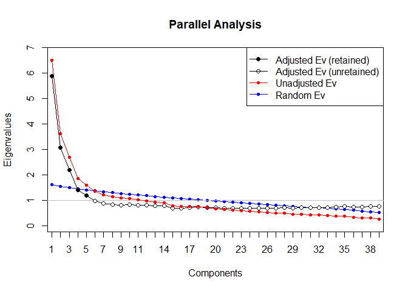

# ASD and Schizotypy 

## Follow Up 1 {.tabset}

### Data Cleaning #1 for FU1

Here we are getting the raw data file from FU1 into a useable form. 


``` r
library(dplyr)
```

```
## 
## Attaching package: 'dplyr'
```

```
## The following objects are masked from 'package:stats':
## 
##     filter, lag
```

```
## The following objects are masked from 'package:base':
## 
##     intersect, setdiff, setequal, union
```

``` r
data_original = read.csv("C:/r_projects/Autism and Schizotypy/asdsz/Schizotypy and Autism_FU1.csv")
content = data_original %>% dplyr::select(MSS._1:SPQ_35)
questions = sapply(sapply(content[1,], strsplit, "- "), "[[",2) 
df=as.data.frame(questions)

write.csv(df, "all questions.csv")

data = data_original %>% filter(id != "")
data = data[-c(1,2),]
data = data %>% dplyr::select(-LocationLatitude, -LocationLongitude, -DistributionChannel, -(RecordedDate:UserLanguage), -IPAddress)
```

Attention Check items; this only includes folks who passed the attention check items. Then, it removes the attention check questions from the data. 


``` r
question = data[1,] %>% as.vector() %>% unlist() %>% unname()
name = colnames(data)
quest_df = data.frame(question, name)

data_attention_checked = data %>% filter(MSS._7 == "TRUE") %>%
  filter(AQ._11 == "Strongly Agree") %>%
  filter(AQ._33 == "Neutral") %>%
  filter(SeSS_14 == "Always") %>%
  filter(SeSS_28 == "Prefer Not to Answer") %>%
  filter(ASI_4 == "NO") %>% 
  filter(WSS_7 == "TRUE") %>% 
  filter(WSS_36 == "FALSE") %>% 
  filter(WSS_55 == "FALSE") %>% 
  filter(SPQ_8 == "Agree") %>% 
  filter(SPQ_33 == "Strongly Agree") %>%
  select(-MSS._7,-AQ._11, -AQ._33, -SeSS_14, -SeSS_28, -ASI_4, -WSS_7, -WSS_36, -WSS_55, -SPQ_8, -SPQ_33)

data_attention_checked[data_attention_checked == "" | data_attention_checked == "Prefer Not to Answer"] = NA
```

We also need to remove people who have been living in the US for two years or less and who answered less than 90% of the survey. 


``` r
data_attention_checked$US = as.numeric(data_attention_checked$US)
data_attention_checked = data_attention_checked %>% filter(US >= 2 & US < 100)

data_content = data_attention_checked %>% select(MSS._1:SPQ_35) 
check_empty_prop = function(x){sum(is.na(x)) /ncol(data_content)}
data_attention_checked$empty_prop =apply(data_content, 1, check_empty_prop)

data_attention_checked = data_attention_checked %>% filter(empty_prop < 0.1)

data_attention_checked = data_attention_checked %>% select(-empty_prop)
```

Here we are changing responses to true/false (logical) or numeric (for Likert-style responses).


``` r
data_attention_checked[data_attention_checked == "TRUE"] = T
data_attention_checked[data_attention_checked == "FALSE"] = F
data_attention_checked[data_attention_checked == "Strongly Disagree"] = 1
data_attention_checked[data_attention_checked == "Disagree"] = 2
data_attention_checked[data_attention_checked == "Neutral"] = 3
data_attention_checked[data_attention_checked == "Agree"] = 4
data_attention_checked[data_attention_checked == "Strongly Agree"] = 5

data_attention_checked[data_attention_checked == "Never"] = 1
data_attention_checked[data_attention_checked == "Rarely"] = 2
data_attention_checked[data_attention_checked == "Occasionally"] = 3
data_attention_checked[data_attention_checked == "Usually"] = 4
data_attention_checked[data_attention_checked == "Always"] = 5

data_attention_checked[data_attention_checked == "YES"] = TRUE
data_attention_checked[data_attention_checked == "NO"] = FALSE

df_boolean = data_attention_checked %>% select(contains(c("MSS", "ASI", "WSS"))) %>% mutate_all(as.logical)
df_numeric = data_attention_checked %>% select(contains(c("SeSS", "SPQ", "AQ"))) %>% mutate_all(as.integer)

df_content = cbind(ID = data_attention_checked$ID, df_boolean, df_numeric)
```

Reverse score the necessary items.


``` r
df_content$AQ._18 = 6 - df_content$AQ._18
df_content$AQ._20 = 6 - df_content$AQ._20
df_content$AQ._21 = 6 - df_content$AQ._21 
df_content$AQ._22 = 6 - df_content$AQ._22
df_content$AQ._23 = 6 - df_content$AQ._23
df_content$AQ._25 = 6 - df_content$AQ._25
df_content$AQ._26 = 6 - df_content$AQ._26
df_content$AQ._27 = 6 - df_content$AQ._27
df_content$AQ._28 = 6 - df_content$AQ._28
df_content$AQ._30 = 6 - df_content$AQ._30
df_content$AQ._31 = 6 - df_content$AQ._31
df_content$AQ._32 = 6 - df_content$AQ._32
df_content$AQ._36 = 6 - df_content$AQ._36
df_content$AQ._37 = 6 - df_content$AQ._37
df_content$AQ._38 = 6 - df_content$AQ._38
df_content$AQ._39 = 6 - df_content$AQ._39
df_content$AQ._40 = 6 - df_content$AQ._40

df_content$WSS_12 = !df_content$WSS_12
df_content$WSS_35 = !df_content$WSS_35
df_content$WSS_41 = !df_content$WSS_41
df_content$WSS_43 = !df_content$WSS_43
df_content$WSS_44 = !df_content$WSS_44
df_content$WSS_45 = !df_content$WSS_45
df_content$WSS_46 = !df_content$WSS_46
df_content$WSS_48 = !df_content$WSS_48
df_content$WSS_49 = !df_content$WSS_49
df_content$WSS_50 = !df_content$WSS_50
df_content$WSS_51 = !df_content$WSS_51
df_content$WSS_54 = !df_content$WSS_54
df_content$WSS_57 = !df_content$WSS_57
df_content$WSS_59 = !df_content$WSS_59
df_content$WSS_60 = !df_content$WSS_60
df_content$WSS_61 = !df_content$WSS_61
df_content$WSS_62 = !df_content$WSS_62
df_content$WSS_63 = !df_content$WSS_63
```

And save the cleaned data as a cvs!

``` r
write.csv(df_content, "survey content.csv")
```

### Autism Quotient factors 

Now that our data are useable, we need to look at the factor structure of the Autism Quotient (AQ) and to select the autism items to be retained for the remaining analyses. 


``` r
library(dplyr)
library(psych)
library(paran)
```

```
## Loading required package: MASS
```

```
## 
## Attaching package: 'MASS'
```

```
## The following object is masked from 'package:dplyr':
## 
##     select
```

``` r
library(lavaan)
```

```
## This is lavaan 0.7-3
## lavaan is FREE software! Please report any bugs.
```

```
## 
## Attaching package: 'lavaan'
```

```
## The following object is masked from 'package:psych':
## 
##     cor2cov
```

``` r
library(mice)
```

```
## 
## Attaching package: 'mice'
```

```
## The following object is masked from 'package:stats':
## 
##     filter
```

```
## The following objects are masked from 'package:base':
## 
##     cbind, rbind
```

Impute missing values 

``` r
survey_original = read.csv("survey content.csv")

AQ = survey_original %>% dplyr::select(contains("AQ"))

AQ_imputed_results = mice(AQ, seed = 1234)
```

```
## 
##  iter imp variable
##   1   1  AQ._4  AQ._12  AQ._14  AQ._16  AQ._18  AQ._19  AQ._20  AQ._21  AQ._22  AQ._23  AQ._24  AQ._25  AQ._26  AQ._27  AQ._28  AQ._30  AQ._32  AQ._34  AQ._35  AQ._36  AQ._37  AQ._38  AQ._40  AQ._41
##   1   2  AQ._4  AQ._12  AQ._14  AQ._16  AQ._18  AQ._19  AQ._20  AQ._21  AQ._22  AQ._23  AQ._24  AQ._25  AQ._26  AQ._27  AQ._28  AQ._30  AQ._32  AQ._34  AQ._35  AQ._36  AQ._37  AQ._38  AQ._40  AQ._41
##   1   3  AQ._4  AQ._12  AQ._14  AQ._16  AQ._18  AQ._19  AQ._20  AQ._21  AQ._22  AQ._23  AQ._24  AQ._25  AQ._26  AQ._27  AQ._28  AQ._30  AQ._32  AQ._34  AQ._35  AQ._36  AQ._37  AQ._38  AQ._40  AQ._41
##   1   4  AQ._4  AQ._12  AQ._14  AQ._16  AQ._18  AQ._19  AQ._20  AQ._21  AQ._22  AQ._23  AQ._24  AQ._25  AQ._26  AQ._27  AQ._28  AQ._30  AQ._32  AQ._34  AQ._35  AQ._36  AQ._37  AQ._38  AQ._40  AQ._41
##   1   5  AQ._4  AQ._12  AQ._14  AQ._16  AQ._18  AQ._19  AQ._20  AQ._21  AQ._22  AQ._23  AQ._24  AQ._25  AQ._26  AQ._27  AQ._28  AQ._30  AQ._32  AQ._34  AQ._35  AQ._36  AQ._37  AQ._38  AQ._40  AQ._41
##   2   1  AQ._4  AQ._12  AQ._14  AQ._16  AQ._18  AQ._19  AQ._20  AQ._21  AQ._22  AQ._23  AQ._24  AQ._25  AQ._26  AQ._27  AQ._28  AQ._30  AQ._32  AQ._34  AQ._35  AQ._36  AQ._37  AQ._38  AQ._40  AQ._41
##   2   2  AQ._4  AQ._12  AQ._14  AQ._16  AQ._18  AQ._19  AQ._20  AQ._21  AQ._22  AQ._23  AQ._24  AQ._25  AQ._26  AQ._27  AQ._28  AQ._30  AQ._32  AQ._34  AQ._35  AQ._36  AQ._37  AQ._38  AQ._40  AQ._41
##   2   3  AQ._4  AQ._12  AQ._14  AQ._16  AQ._18  AQ._19  AQ._20  AQ._21  AQ._22  AQ._23  AQ._24  AQ._25  AQ._26  AQ._27  AQ._28  AQ._30  AQ._32  AQ._34  AQ._35  AQ._36  AQ._37  AQ._38  AQ._40  AQ._41
##   2   4  AQ._4  AQ._12  AQ._14  AQ._16  AQ._18  AQ._19  AQ._20  AQ._21  AQ._22  AQ._23  AQ._24  AQ._25  AQ._26  AQ._27  AQ._28  AQ._30  AQ._32  AQ._34  AQ._35  AQ._36  AQ._37  AQ._38  AQ._40  AQ._41
##   2   5  AQ._4  AQ._12  AQ._14  AQ._16  AQ._18  AQ._19  AQ._20  AQ._21  AQ._22  AQ._23  AQ._24  AQ._25  AQ._26  AQ._27  AQ._28  AQ._30  AQ._32  AQ._34  AQ._35  AQ._36  AQ._37  AQ._38  AQ._40  AQ._41
##   3   1  AQ._4  AQ._12  AQ._14  AQ._16  AQ._18  AQ._19  AQ._20  AQ._21  AQ._22  AQ._23  AQ._24  AQ._25  AQ._26  AQ._27  AQ._28  AQ._30  AQ._32  AQ._34  AQ._35  AQ._36  AQ._37  AQ._38  AQ._40  AQ._41
##   3   2  AQ._4  AQ._12  AQ._14  AQ._16  AQ._18  AQ._19  AQ._20  AQ._21  AQ._22  AQ._23  AQ._24  AQ._25  AQ._26  AQ._27  AQ._28  AQ._30  AQ._32  AQ._34  AQ._35  AQ._36  AQ._37  AQ._38  AQ._40  AQ._41
##   3   3  AQ._4  AQ._12  AQ._14  AQ._16  AQ._18  AQ._19  AQ._20  AQ._21  AQ._22  AQ._23  AQ._24  AQ._25  AQ._26  AQ._27  AQ._28  AQ._30  AQ._32  AQ._34  AQ._35  AQ._36  AQ._37  AQ._38  AQ._40  AQ._41
##   3   4  AQ._4  AQ._12  AQ._14  AQ._16  AQ._18  AQ._19  AQ._20  AQ._21  AQ._22  AQ._23  AQ._24  AQ._25  AQ._26  AQ._27  AQ._28  AQ._30  AQ._32  AQ._34  AQ._35  AQ._36  AQ._37  AQ._38  AQ._40  AQ._41
##   3   5  AQ._4  AQ._12  AQ._14  AQ._16  AQ._18  AQ._19  AQ._20  AQ._21  AQ._22  AQ._23  AQ._24  AQ._25  AQ._26  AQ._27  AQ._28  AQ._30  AQ._32  AQ._34  AQ._35  AQ._36  AQ._37  AQ._38  AQ._40  AQ._41
##   4   1  AQ._4  AQ._12  AQ._14  AQ._16  AQ._18  AQ._19  AQ._20  AQ._21  AQ._22  AQ._23  AQ._24  AQ._25  AQ._26  AQ._27  AQ._28  AQ._30  AQ._32  AQ._34  AQ._35  AQ._36  AQ._37  AQ._38  AQ._40  AQ._41
##   4   2  AQ._4  AQ._12  AQ._14  AQ._16  AQ._18  AQ._19  AQ._20  AQ._21  AQ._22  AQ._23  AQ._24  AQ._25  AQ._26  AQ._27  AQ._28  AQ._30  AQ._32  AQ._34  AQ._35  AQ._36  AQ._37  AQ._38  AQ._40  AQ._41
##   4   3  AQ._4  AQ._12  AQ._14  AQ._16  AQ._18  AQ._19  AQ._20  AQ._21  AQ._22  AQ._23  AQ._24  AQ._25  AQ._26  AQ._27  AQ._28  AQ._30  AQ._32  AQ._34  AQ._35  AQ._36  AQ._37  AQ._38  AQ._40  AQ._41
##   4   4  AQ._4  AQ._12  AQ._14  AQ._16  AQ._18  AQ._19  AQ._20  AQ._21  AQ._22  AQ._23  AQ._24  AQ._25  AQ._26  AQ._27  AQ._28  AQ._30  AQ._32  AQ._34  AQ._35  AQ._36  AQ._37  AQ._38  AQ._40  AQ._41
##   4   5  AQ._4  AQ._12  AQ._14  AQ._16  AQ._18  AQ._19  AQ._20  AQ._21  AQ._22  AQ._23  AQ._24  AQ._25  AQ._26  AQ._27  AQ._28  AQ._30  AQ._32  AQ._34  AQ._35  AQ._36  AQ._37  AQ._38  AQ._40  AQ._41
##   5   1  AQ._4  AQ._12  AQ._14  AQ._16  AQ._18  AQ._19  AQ._20  AQ._21  AQ._22  AQ._23  AQ._24  AQ._25  AQ._26  AQ._27  AQ._28  AQ._30  AQ._32  AQ._34  AQ._35  AQ._36  AQ._37  AQ._38  AQ._40  AQ._41
##   5   2  AQ._4  AQ._12  AQ._14  AQ._16  AQ._18  AQ._19  AQ._20  AQ._21  AQ._22  AQ._23  AQ._24  AQ._25  AQ._26  AQ._27  AQ._28  AQ._30  AQ._32  AQ._34  AQ._35  AQ._36  AQ._37  AQ._38  AQ._40  AQ._41
##   5   3  AQ._4  AQ._12  AQ._14  AQ._16  AQ._18  AQ._19  AQ._20  AQ._21  AQ._22  AQ._23  AQ._24  AQ._25  AQ._26  AQ._27  AQ._28  AQ._30  AQ._32  AQ._34  AQ._35  AQ._36  AQ._37  AQ._38  AQ._40  AQ._41
##   5   4  AQ._4  AQ._12  AQ._14  AQ._16  AQ._18  AQ._19  AQ._20  AQ._21  AQ._22  AQ._23  AQ._24  AQ._25  AQ._26  AQ._27  AQ._28  AQ._30  AQ._32  AQ._34  AQ._35  AQ._36  AQ._37  AQ._38  AQ._40  AQ._41
##   5   5  AQ._4  AQ._12  AQ._14  AQ._16  AQ._18  AQ._19  AQ._20  AQ._21  AQ._22  AQ._23  AQ._24  AQ._25  AQ._26  AQ._27  AQ._28  AQ._30  AQ._32  AQ._34  AQ._35  AQ._36  AQ._37  AQ._38  AQ._40  AQ._41
```

``` r
AQ_imputed = complete(AQ_imputed_results,2)
AQ_imputed = data.frame(ID = survey_original$ID, AQ_imputed)
write.csv(AQ_imputed, "AQ imputed.csv")
```
Pull AQ items only, which has 39 questions total. 

``` r
survey = read.csv("AQ imputed.csv") %>% dplyr::select(-X, -ID)
```

The first step is to look at the internal consistency and performance of the AQ factors. Note that I am not entirely confident as to why certain items were excluded when examining these factors beyond replication from Zhu et al., (2022). 

Social Discourse Convention Items, to look at internal consistency of 1) the original Social Discourse convention items from Zhu et al. (2022); 2) all Social Discourse Convention items, including items from BAAP and SRS-2; and 3) all Social Discourse Convention items minus from SRS-2 (i.e., AQ._5).

``` r
##Zhu (2022) Social Discourse Convention Items 
survey %>% dplyr::select(AQ._1:AQ._3) %>% corr.test()
```

```
## Call:corr.test(x = .)
## Correlation matrix 
##       AQ._1 AQ._2 AQ._3
## AQ._1  1.00  0.32  0.38
## AQ._2  0.32  1.00  0.30
## AQ._3  0.38  0.30  1.00
## Sample Size 
## [1] 422
## Probability values (Entries above the diagonal are adjusted for multiple tests.) 
##       AQ._1 AQ._2 AQ._3
## AQ._1     0     0     0
## AQ._2     0     0     0
## AQ._3     0     0     0
## 
##  To see confidence intervals of the correlations, print with the short=FALSE option
```

``` r
survey %>% dplyr::select(AQ._1:AQ._3) %>% performance::item_intercor()
```

```
## [1] 0.3313883
```

``` r
survey %>% dplyr::select(AQ._1:AQ._3) %>% psych::alpha()
```

```
## 
## Reliability analysis   
## Call: psych::alpha(x = .)
## 
##   raw_alpha std.alpha G6(smc) average_r S/N   ase mean  sd median_r
##        0.6       0.6     0.5      0.33 1.5 0.034  2.3 0.8     0.32
## 
##     95% confidence boundaries 
##          lower alpha upper
## Feldt     0.52   0.6  0.66
## Duhachek  0.53   0.6  0.66
## 
##  Reliability if an item is dropped:
##       raw_alpha std.alpha G6(smc) average_r  S/N alpha se var.r med.r
## AQ._1      0.46      0.46    0.30      0.30 0.84    0.053    NA  0.30
## AQ._2      0.54      0.55    0.38      0.38 1.21    0.044    NA  0.38
## AQ._3      0.49      0.49    0.32      0.32 0.95    0.050    NA  0.32
## 
##  Item statistics 
##         n raw.r std.r r.cor r.drop mean   sd
## AQ._1 422  0.79  0.76  0.56   0.43  2.6 1.18
## AQ._2 422  0.72  0.72  0.48   0.37  2.0 1.05
## AQ._3 422  0.72  0.75  0.54   0.42  2.3 0.98
## 
## Non missing response frequency for each item
##          1    2    3    4    5 miss
## AQ._1 0.15 0.43 0.15 0.19 0.08    0
## AQ._2 0.33 0.46 0.09 0.08 0.04    0
## AQ._3 0.20 0.50 0.16 0.11 0.02    0
```

``` r
##all Social Discourse Convention items, including items from BAAP and SRS-2
survey %>% dplyr::select(AQ._1:AQ._8) %>% performance::item_intercor()
```

```
## [1] 0.3212605
```

``` r
survey %>% dplyr::select(AQ._1:AQ._8) %>% psych::alpha()
```

```
## 
## Reliability analysis   
## Call: psych::alpha(x = .)
## 
##   raw_alpha std.alpha G6(smc) average_r S/N   ase mean  sd median_r
##       0.79      0.79    0.79      0.32 3.8 0.015  2.5 0.7     0.32
## 
##     95% confidence boundaries 
##          lower alpha upper
## Feldt     0.76  0.79  0.82
## Duhachek  0.76  0.79  0.82
## 
##  Reliability if an item is dropped:
##       raw_alpha std.alpha G6(smc) average_r S/N alpha se  var.r med.r
## AQ._1      0.77      0.77    0.76      0.32 3.3    0.017 0.0084  0.32
## AQ._2      0.76      0.76    0.76      0.31 3.2    0.018 0.0095  0.30
## AQ._3      0.77      0.77    0.75      0.32 3.3    0.017 0.0056  0.32
## AQ._4      0.76      0.76    0.75      0.31 3.2    0.018 0.0066  0.31
## AQ._5      0.77      0.77    0.76      0.33 3.4    0.017 0.0090  0.32
## AQ._6      0.76      0.76    0.75      0.32 3.2    0.018 0.0090  0.31
## AQ._7      0.78      0.79    0.77      0.34 3.7    0.016 0.0049  0.34
## AQ._8      0.77      0.76    0.75      0.32 3.2    0.017 0.0074  0.32
## 
##  Item statistics 
##         n raw.r std.r r.cor r.drop mean   sd
## AQ._1 422  0.65  0.64  0.57   0.51  2.6 1.18
## AQ._2 422  0.66  0.67  0.60   0.54  2.0 1.05
## AQ._3 422  0.63  0.64  0.58   0.50  2.3 0.98
## AQ._4 422  0.69  0.68  0.62   0.54  2.5 1.19
## AQ._5 422  0.62  0.62  0.53   0.47  2.8 1.16
## AQ._6 422  0.67  0.66  0.59   0.53  3.1 1.20
## AQ._7 422  0.54  0.54  0.44   0.39  2.4 1.02
## AQ._8 422  0.63  0.65  0.59   0.51  2.2 0.94
## 
## Non missing response frequency for each item
##          1    2    3    4    5 miss
## AQ._1 0.15 0.43 0.15 0.19 0.08    0
## AQ._2 0.33 0.46 0.09 0.08 0.04    0
## AQ._3 0.20 0.50 0.16 0.11 0.02    0
## AQ._4 0.21 0.41 0.15 0.17 0.07    0
## AQ._5 0.10 0.39 0.21 0.21 0.09    0
## AQ._6 0.07 0.31 0.19 0.28 0.15    0
## AQ._7 0.15 0.50 0.17 0.14 0.04    0
## AQ._8 0.20 0.54 0.15 0.08 0.03    0
```

``` r
##all Social Discourse Convention items minus item from SRS-2 (i.e., AQ._5)
survey %>% dplyr::select(AQ._1:AQ._8, -AQ._5) %>% psych::alpha()
```

```
## 
## Reliability analysis   
## Call: psych::alpha(x = .)
## 
##   raw_alpha std.alpha G6(smc) average_r S/N   ase mean  sd median_r
##       0.77      0.77    0.76      0.33 3.4 0.017  2.5 0.7     0.32
## 
##     95% confidence boundaries 
##          lower alpha upper
## Feldt     0.74  0.77   0.8
## Duhachek  0.74  0.77   0.8
## 
##  Reliability if an item is dropped:
##       raw_alpha std.alpha G6(smc) average_r S/N alpha se  var.r med.r
## AQ._1      0.74      0.74    0.72      0.32 2.9    0.019 0.0106  0.32
## AQ._2      0.74      0.74    0.72      0.32 2.8    0.020 0.0120  0.32
## AQ._3      0.74      0.74    0.72      0.32 2.9    0.019 0.0065  0.32
## AQ._4      0.73      0.73    0.71      0.31 2.7    0.020 0.0081  0.31
## AQ._6      0.74      0.74    0.72      0.32 2.9    0.020 0.0112  0.32
## AQ._7      0.77      0.78    0.75      0.37 3.5    0.017 0.0045  0.38
## AQ._8      0.74      0.74    0.72      0.32 2.8    0.019 0.0090  0.32
## 
##  Item statistics 
##         n raw.r std.r r.cor r.drop mean   sd
## AQ._1 422  0.68  0.66  0.58   0.51  2.6 1.18
## AQ._2 422  0.67  0.67  0.59   0.52  2.0 1.05
## AQ._3 422  0.65  0.66  0.59   0.50  2.3 0.98
## AQ._4 422  0.72  0.71  0.65   0.56  2.5 1.19
## AQ._6 422  0.69  0.66  0.59   0.52  3.1 1.20
## AQ._7 422  0.51  0.52  0.38   0.33  2.4 1.02
## AQ._8 422  0.65  0.67  0.60   0.51  2.2 0.94
## 
## Non missing response frequency for each item
##          1    2    3    4    5 miss
## AQ._1 0.15 0.43 0.15 0.19 0.08    0
## AQ._2 0.33 0.46 0.09 0.08 0.04    0
## AQ._3 0.20 0.50 0.16 0.11 0.02    0
## AQ._4 0.21 0.41 0.15 0.17 0.07    0
## AQ._6 0.07 0.31 0.19 0.28 0.15    0
## AQ._7 0.15 0.50 0.17 0.14 0.04    0
## AQ._8 0.20 0.54 0.15 0.08 0.03    0
```

Interest in Details/Pattern Items, to look at internal consistency of 1) the original Interest in Details/Pattern items from Zhu et al., (2022); 2) all Interest in Details/Pattern items, including items from IASQ; and 3) all Interest in Details/Pattern items, but excluding items 15 and 16 (which I assume was originally due to poor fit but can't be sure; this was what Iris had included).

``` r
##Zhu (2022) Interest in Details/Pattern Items 
survey %>% dplyr::select(AQ._9:AQ._14) %>% corr.test()
```

```
## Call:corr.test(x = .)
## Correlation matrix 
##        AQ._9 AQ._10 AQ._12 AQ._13 AQ._14
## AQ._9   1.00   0.21   0.30   0.25   0.19
## AQ._10  0.21   1.00   0.11   0.37   0.29
## AQ._12  0.30   0.11   1.00   0.21   0.17
## AQ._13  0.25   0.37   0.21   1.00   0.25
## AQ._14  0.19   0.29   0.17   0.25   1.00
## Sample Size 
## [1] 422
## Probability values (Entries above the diagonal are adjusted for multiple tests.) 
##        AQ._9 AQ._10 AQ._12 AQ._13 AQ._14
## AQ._9      0   0.00   0.00      0      0
## AQ._10     0   0.00   0.02      0      0
## AQ._12     0   0.02   0.00      0      0
## AQ._13     0   0.00   0.00      0      0
## AQ._14     0   0.00   0.00      0      0
## 
##  To see confidence intervals of the correlations, print with the short=FALSE option
```

``` r
survey %>% dplyr::select(AQ._9:AQ._14) %>% psych::alpha()
```

```
## 
## Reliability analysis   
## Call: psych::alpha(x = .)
## 
##   raw_alpha std.alpha G6(smc) average_r S/N  ase mean  sd median_r
##        0.6       0.6    0.56      0.23 1.5 0.03  2.8 0.7     0.23
## 
##     95% confidence boundaries 
##          lower alpha upper
## Feldt     0.54   0.6  0.66
## Duhachek  0.54   0.6  0.66
## 
##  Reliability if an item is dropped:
##        raw_alpha std.alpha G6(smc) average_r S/N alpha se  var.r med.r
## AQ._9       0.54      0.55    0.49      0.23 1.2    0.036 0.0083  0.23
## AQ._10      0.54      0.54    0.47      0.23 1.2    0.037 0.0025  0.23
## AQ._12      0.58      0.58    0.52      0.26 1.4    0.033 0.0039  0.25
## AQ._13      0.52      0.52    0.46      0.21 1.1    0.038 0.0055  0.20
## AQ._14      0.56      0.56    0.50      0.24 1.3    0.035 0.0077  0.23
## 
##  Item statistics 
##          n raw.r std.r r.cor r.drop mean   sd
## AQ._9  422  0.62  0.63  0.47   0.37  2.5 1.08
## AQ._10 422  0.61  0.64  0.50   0.38  3.5 0.99
## AQ._12 422  0.58  0.57  0.39   0.30  2.6 1.12
## AQ._13 422  0.69  0.66  0.54   0.41  2.8 1.24
## AQ._14 422  0.61  0.61  0.44   0.34  2.7 1.16
## 
## Non missing response frequency for each item
##           1    2    3    4    5 miss
## AQ._9  0.18 0.41 0.21 0.18 0.04    0
## AQ._10 0.02 0.13 0.32 0.36 0.18    0
## AQ._12 0.16 0.38 0.24 0.15 0.06    0
## AQ._13 0.15 0.35 0.16 0.24 0.09    0
## AQ._14 0.13 0.38 0.21 0.20 0.08    0
```

``` r
##all Interest in Details/Pattern Items, including items from IASQ
survey %>% dplyr::select(AQ._9:AQ._17) %>% psych::alpha()
```

```
## 
## Reliability analysis   
## Call: psych::alpha(x = .)
## 
##   raw_alpha std.alpha G6(smc) average_r S/N   ase mean   sd median_r
##       0.68      0.68    0.68      0.21 2.2 0.023  2.7 0.62      0.2
## 
##     95% confidence boundaries 
##          lower alpha upper
## Feldt     0.63  0.68  0.73
## Duhachek  0.64  0.68  0.73
## 
##  Reliability if an item is dropped:
##        raw_alpha std.alpha G6(smc) average_r S/N alpha se  var.r med.r
## AQ._9       0.66      0.66    0.65      0.22 1.9    0.025 0.0135  0.19
## AQ._10      0.64      0.65    0.64      0.21 1.8    0.026 0.0134  0.19
## AQ._12      0.67      0.67    0.67      0.23 2.1    0.024 0.0125  0.21
## AQ._13      0.64      0.65    0.64      0.21 1.8    0.026 0.0137  0.19
## AQ._14      0.63      0.63    0.62      0.20 1.7    0.028 0.0092  0.19
## AQ._15      0.69      0.69    0.68      0.24 2.2    0.023 0.0110  0.22
## AQ._16      0.66      0.67    0.66      0.22 2.0    0.025 0.0135  0.21
## AQ._17      0.60      0.61    0.59      0.18 1.5    0.029 0.0071  0.18
## 
##  Item statistics 
##          n raw.r std.r r.cor r.drop mean   sd
## AQ._9  422  0.53  0.54  0.43   0.35  2.5 1.08
## AQ._10 422  0.57  0.59  0.50   0.41  3.5 0.99
## AQ._12 422  0.48  0.48  0.35   0.28  2.6 1.12
## AQ._13 422  0.60  0.58  0.49   0.40  2.8 1.24
## AQ._14 422  0.63  0.63  0.58   0.46  2.7 1.16
## AQ._15 422  0.42  0.42  0.25   0.21  2.7 1.16
## AQ._16 422  0.51  0.51  0.39   0.32  2.5 1.10
## AQ._17 422  0.71  0.71  0.70   0.57  2.5 1.10
## 
## Non missing response frequency for each item
##           1    2    3    4    5 miss
## AQ._9  0.18 0.41 0.21 0.18 0.04    0
## AQ._10 0.02 0.13 0.32 0.36 0.18    0
## AQ._12 0.16 0.38 0.24 0.15 0.06    0
## AQ._13 0.15 0.35 0.16 0.24 0.09    0
## AQ._14 0.13 0.38 0.21 0.20 0.08    0
## AQ._15 0.10 0.42 0.20 0.18 0.10    0
## AQ._16 0.15 0.47 0.17 0.15 0.06    0
## AQ._17 0.16 0.43 0.21 0.15 0.06    0
```

``` r
##all Interest in Details/Pattern Items, including items from IASQ but with poorly fitting items excluded
survey %>% dplyr::select(AQ._9:AQ._14, AQ._17) %>% psych::alpha()
```

```
## 
## Reliability analysis   
## Call: psych::alpha(x = .)
## 
##   raw_alpha std.alpha G6(smc) average_r S/N   ase mean   sd median_r
##       0.68      0.68    0.67      0.27 2.2 0.024  2.8 0.69     0.25
## 
##     95% confidence boundaries 
##          lower alpha upper
## Feldt     0.63  0.68  0.73
## Duhachek  0.64  0.68  0.73
## 
##  Reliability if an item is dropped:
##        raw_alpha std.alpha G6(smc) average_r S/N alpha se  var.r med.r
## AQ._9       0.65      0.65    0.63      0.27 1.9    0.027 0.0150  0.26
## AQ._10      0.65      0.65    0.62      0.27 1.8    0.027 0.0120  0.25
## AQ._12      0.68      0.68    0.65      0.30 2.1    0.025 0.0106  0.28
## AQ._13      0.64      0.64    0.62      0.26 1.8    0.027 0.0148  0.25
## AQ._14      0.63      0.63    0.59      0.25 1.7    0.029 0.0050  0.26
## AQ._17      0.60      0.60    0.56      0.23 1.5    0.030 0.0055  0.23
## 
##  Item statistics 
##          n raw.r std.r r.cor r.drop mean   sd
## AQ._9  422  0.59  0.60  0.46   0.38  2.5 1.08
## AQ._10 422  0.59  0.61  0.48   0.40  3.5 0.99
## AQ._12 422  0.54  0.54  0.37   0.31  2.6 1.12
## AQ._13 422  0.65  0.63  0.50   0.41  2.8 1.24
## AQ._14 422  0.66  0.66  0.58   0.45  2.7 1.16
## AQ._17 422  0.71  0.71  0.66   0.53  2.5 1.10
## 
## Non missing response frequency for each item
##           1    2    3    4    5 miss
## AQ._9  0.18 0.41 0.21 0.18 0.04    0
## AQ._10 0.02 0.13 0.32 0.36 0.18    0
## AQ._12 0.16 0.38 0.24 0.15 0.06    0
## AQ._13 0.15 0.35 0.16 0.24 0.09    0
## AQ._14 0.13 0.38 0.21 0.20 0.08    0
## AQ._17 0.16 0.43 0.21 0.15 0.06    0
```
Imagination Ability Items, to look at internal consistency of 1) the original Imagination Ability items from Zhu et al., (2022); 2) all Imagination Ability items, including two new items created for this survey; and 3) all Imagination Ability items, but excluding two new items created for this survey.

``` r
##Zhu (2022) Imagination Ability Items 
survey %>% dplyr::select(AQ._18:AQ._22) %>% corr.test()
```

```
## Call:corr.test(x = .)
## Correlation matrix 
##        AQ._18 AQ._19 AQ._20 AQ._21 AQ._22
## AQ._18   1.00   0.32   0.21   0.17   0.54
## AQ._19   0.32   1.00   0.09   0.20   0.21
## AQ._20   0.21   0.09   1.00   0.31   0.16
## AQ._21   0.17   0.20   0.31   1.00   0.15
## AQ._22   0.54   0.21   0.16   0.15   1.00
## Sample Size 
## [1] 422
## Probability values (Entries above the diagonal are adjusted for multiple tests.) 
##        AQ._18 AQ._19 AQ._20 AQ._21 AQ._22
## AQ._18      0   0.00   0.00      0      0
## AQ._19      0   0.00   0.07      0      0
## AQ._20      0   0.07   0.00      0      0
## AQ._21      0   0.00   0.00      0      0
## AQ._22      0   0.00   0.00      0      0
## 
##  To see confidence intervals of the correlations, print with the short=FALSE option
```

``` r
survey %>% dplyr::select(AQ._18:AQ._22) %>% psych::alpha()
```

```
## 
## Reliability analysis   
## Call: psych::alpha(x = .)
## 
##   raw_alpha std.alpha G6(smc) average_r S/N   ase mean   sd median_r
##       0.61      0.61    0.59      0.24 1.6 0.031  2.1 0.64      0.2
## 
##     95% confidence boundaries 
##          lower alpha upper
## Feldt     0.54  0.61  0.66
## Duhachek  0.55  0.61  0.67
## 
##  Reliability if an item is dropped:
##        raw_alpha std.alpha G6(smc) average_r  S/N alpha se  var.r med.r
## AQ._18      0.48      0.48    0.42      0.19 0.92    0.042 0.0057  0.18
## AQ._19      0.58      0.58    0.56      0.26 1.39    0.034 0.0230  0.19
## AQ._20      0.59      0.59    0.56      0.27 1.45    0.033 0.0220  0.20
## AQ._21      0.57      0.58    0.55      0.26 1.38    0.034 0.0255  0.21
## AQ._22      0.52      0.53    0.47      0.22 1.11    0.038 0.0081  0.20
## 
##  Item statistics 
##          n raw.r std.r r.cor r.drop mean   sd
## AQ._18 422  0.71  0.72  0.67   0.50  2.1 1.01
## AQ._19 422  0.59  0.58  0.39   0.31  2.1 1.06
## AQ._20 422  0.58  0.57  0.38   0.29  2.4 1.08
## AQ._21 422  0.58  0.59  0.40   0.32  1.9 0.99
## AQ._22 422  0.65  0.66  0.57   0.41  2.1 0.99
## 
## Non missing response frequency for each item
##           1    2    3    4    5 miss
## AQ._18 0.27 0.46 0.15 0.09 0.03    0
## AQ._19 0.35 0.41 0.13 0.08 0.04    0
## AQ._20 0.20 0.42 0.20 0.14 0.04    0
## AQ._21 0.39 0.40 0.11 0.08 0.02    0
## AQ._22 0.27 0.47 0.14 0.09 0.02    0
```

``` r
##all Imagination Ability Items, including two new items 
survey %>% dplyr::select(AQ._18:AQ._26) %>% corr.test()
```

```
## Call:corr.test(x = .)
## Correlation matrix 
##        AQ._18 AQ._19 AQ._20 AQ._21 AQ._22 AQ._23 AQ._24 AQ._25 AQ._26
## AQ._18   1.00   0.32   0.21   0.17   0.54   0.14   0.19   0.48   0.35
## AQ._19   0.32   1.00   0.09   0.20   0.21   0.04   0.02   0.30   0.09
## AQ._20   0.21   0.09   1.00   0.31   0.16   0.00   0.06   0.20   0.15
## AQ._21   0.17   0.20   0.31   1.00   0.15   0.18  -0.02   0.28   0.10
## AQ._22   0.54   0.21   0.16   0.15   1.00   0.21   0.18   0.47   0.28
## AQ._23   0.14   0.04   0.00   0.18   0.21   1.00   0.12   0.21   0.09
## AQ._24   0.19   0.02   0.06  -0.02   0.18   0.12   1.00   0.13   0.07
## AQ._25   0.48   0.30   0.20   0.28   0.47   0.21   0.13   1.00   0.28
## AQ._26   0.35   0.09   0.15   0.10   0.28   0.09   0.07   0.28   1.00
## Sample Size 
## [1] 422
## Probability values (Entries above the diagonal are adjusted for multiple tests.) 
##        AQ._18 AQ._19 AQ._20 AQ._21 AQ._22 AQ._23 AQ._24 AQ._25 AQ._26
## AQ._18      0   0.00   0.00   0.01   0.00   0.04   0.00   0.00   0.00
## AQ._19      0   0.00   0.60   0.00   0.00   1.00   1.00   0.00   0.60
## AQ._20      0   0.07   0.00   0.00   0.02   1.00   1.00   0.00   0.03
## AQ._21      0   0.00   0.00   0.00   0.02   0.00   1.00   0.00   0.36
## AQ._22      0   0.00   0.00   0.00   0.00   0.00   0.00   0.00   0.00
## AQ._23      0   0.41   0.94   0.00   0.00   0.00   0.20   0.00   0.60
## AQ._24      0   0.64   0.22   0.67   0.00   0.02   0.00   0.08   1.00
## AQ._25      0   0.00   0.00   0.00   0.00   0.00   0.01   0.00   0.00
## AQ._26      0   0.07   0.00   0.04   0.00   0.08   0.18   0.00   0.00
## 
##  To see confidence intervals of the correlations, print with the short=FALSE option
```

``` r
survey %>% dplyr::select(AQ._18:AQ._26) %>% psych::alpha()
```

```
## 
## Reliability analysis   
## Call: psych::alpha(x = .)
## 
##   raw_alpha std.alpha G6(smc) average_r S/N   ase mean   sd median_r
##       0.67      0.68    0.69      0.19 2.2 0.024  2.2 0.54     0.18
## 
##     95% confidence boundaries 
##          lower alpha upper
## Feldt     0.62  0.67  0.72
## Duhachek  0.62  0.67  0.72
## 
##  Reliability if an item is dropped:
##        raw_alpha std.alpha G6(smc) average_r S/N alpha se var.r med.r
## AQ._18      0.59      0.61    0.61      0.16 1.6    0.030 0.012  0.16
## AQ._19      0.66      0.67    0.67      0.20 2.0    0.025 0.018  0.18
## AQ._20      0.66      0.67    0.68      0.21 2.1    0.025 0.019  0.18
## AQ._21      0.65      0.67    0.67      0.20 2.0    0.026 0.019  0.18
## AQ._22      0.61      0.62    0.62      0.17 1.6    0.029 0.014  0.16
## AQ._23      0.67      0.68    0.69      0.21 2.2    0.024 0.019  0.19
## AQ._24      0.68      0.70    0.70      0.22 2.3    0.023 0.017  0.20
## AQ._25      0.61      0.61    0.62      0.16 1.6    0.029 0.014  0.16
## AQ._26      0.65      0.66    0.67      0.20 2.0    0.026 0.019  0.18
## 
##  Item statistics 
##          n raw.r std.r r.cor r.drop mean   sd
## AQ._18 422  0.71  0.71  0.71   0.58  2.1 1.01
## AQ._19 422  0.48  0.48  0.36   0.28  2.1 1.06
## AQ._20 422  0.47  0.46  0.33   0.27  2.4 1.08
## AQ._21 422  0.49  0.49  0.39   0.31  1.9 0.99
## AQ._22 422  0.66  0.67  0.65   0.52  2.1 0.99
## AQ._23 422  0.41  0.41  0.27   0.21  2.2 1.04
## AQ._24 422  0.37  0.36  0.20   0.16  2.9 1.07
## AQ._25 422  0.67  0.70  0.68   0.56  1.9 0.83
## AQ._26 422  0.52  0.50  0.39   0.31  2.5 1.13
## 
## Non missing response frequency for each item
##           1    2    3    4    5 miss
## AQ._18 0.27 0.46 0.15 0.09 0.03    0
## AQ._19 0.35 0.41 0.13 0.08 0.04    0
## AQ._20 0.20 0.42 0.20 0.14 0.04    0
## AQ._21 0.39 0.40 0.11 0.08 0.02    0
## AQ._22 0.27 0.47 0.14 0.09 0.02    0
## AQ._23 0.27 0.43 0.17 0.10 0.03    0
## AQ._24 0.06 0.36 0.24 0.27 0.07    0
## AQ._25 0.34 0.49 0.12 0.04 0.01    0
## AQ._26 0.18 0.43 0.16 0.18 0.05    0
```

``` r
##all Imagination Ability Items, but with two new items dropped
survey %>% dplyr::select(AQ._18:AQ._26, -AQ._23,-AQ._24) %>% psych::alpha()
```

```
## 
## Reliability analysis   
## Call: psych::alpha(x = .)
## 
##   raw_alpha std.alpha G6(smc) average_r S/N   ase mean  sd median_r
##       0.69       0.7     0.7      0.25 2.4 0.023  2.1 0.6     0.21
## 
##     95% confidence boundaries 
##          lower alpha upper
## Feldt     0.65  0.69  0.74
## Duhachek  0.65  0.69  0.74
## 
##  Reliability if an item is dropped:
##        raw_alpha std.alpha G6(smc) average_r S/N alpha se var.r med.r
## AQ._18      0.61      0.63    0.61      0.22 1.7    0.030 0.011  0.20
## AQ._19      0.68      0.69    0.68      0.28 2.3    0.024 0.018  0.28
## AQ._20      0.69      0.70    0.69      0.28 2.3    0.023 0.019  0.28
## AQ._21      0.68      0.70    0.68      0.28 2.3    0.024 0.019  0.28
## AQ._22      0.64      0.65    0.63      0.23 1.8    0.028 0.012  0.21
## AQ._25      0.63      0.63    0.62      0.22 1.7    0.028 0.015  0.20
## AQ._26      0.68      0.69    0.68      0.27 2.3    0.024 0.018  0.21
## 
##  Item statistics 
##          n raw.r std.r r.cor r.drop mean   sd
## AQ._18 422  0.73  0.73  0.71   0.58  2.1 1.01
## AQ._19 422  0.53  0.53  0.39   0.31  2.1 1.06
## AQ._20 422  0.52  0.50  0.36   0.29  2.4 1.08
## AQ._21 422  0.52  0.53  0.39   0.32  1.9 0.99
## AQ._22 422  0.66  0.67  0.62   0.49  2.1 0.99
## AQ._25 422  0.69  0.71  0.67   0.56  1.9 0.83
## AQ._26 422  0.55  0.53  0.40   0.33  2.5 1.13
## 
## Non missing response frequency for each item
##           1    2    3    4    5 miss
## AQ._18 0.27 0.46 0.15 0.09 0.03    0
## AQ._19 0.35 0.41 0.13 0.08 0.04    0
## AQ._20 0.20 0.42 0.20 0.14 0.04    0
## AQ._21 0.39 0.40 0.11 0.08 0.02    0
## AQ._22 0.27 0.47 0.14 0.09 0.02    0
## AQ._25 0.34 0.49 0.12 0.04 0.01    0
## AQ._26 0.18 0.43 0.16 0.18 0.05    0
```

Social Cognition Items, to look at internal consistency of 1) the original Social Cognition items from Zhu et al., (2022); 2) all Social Cognition items, including including item from IASQ; and 3) all Social Cognition Items, but with item from IASQ dropped.


``` r
##Zhu (2022) Social Cognition Items 
survey %>% dplyr::select(AQ._27:AQ._30) %>% corr.test()
```

```
## Call:corr.test(x = .)
## Correlation matrix 
##        AQ._27 AQ._28 AQ._29 AQ._30
## AQ._27   1.00   0.42   0.24   0.36
## AQ._28   0.42   1.00   0.17   0.34
## AQ._29   0.24   0.17   1.00   0.20
## AQ._30   0.36   0.34   0.20   1.00
## Sample Size 
## [1] 422
## Probability values (Entries above the diagonal are adjusted for multiple tests.) 
##        AQ._27 AQ._28 AQ._29 AQ._30
## AQ._27      0      0      0      0
## AQ._28      0      0      0      0
## AQ._29      0      0      0      0
## AQ._30      0      0      0      0
## 
##  To see confidence intervals of the correlations, print with the short=FALSE option
```

``` r
survey %>% dplyr::select(AQ._27:AQ._30) %>% psych::alpha()
```

```
## 
## Reliability analysis   
## Call: psych::alpha(x = .)
## 
##   raw_alpha std.alpha G6(smc) average_r S/N   ase mean   sd median_r
##       0.61      0.62    0.56      0.29 1.6 0.031  2.3 0.65     0.29
## 
##     95% confidence boundaries 
##          lower alpha upper
## Feldt     0.55  0.61  0.67
## Duhachek  0.55  0.61  0.67
## 
##  Reliability if an item is dropped:
##        raw_alpha std.alpha G6(smc) average_r  S/N alpha se  var.r med.r
## AQ._27      0.47      0.48    0.39      0.24 0.93    0.045 0.0084  0.20
## AQ._28      0.52      0.52    0.43      0.27 1.09    0.041 0.0064  0.24
## AQ._29      0.64      0.64    0.54      0.37 1.77    0.030 0.0016  0.36
## AQ._30      0.53      0.53    0.45      0.28 1.14    0.040 0.0162  0.24
## 
##  Item statistics 
##          n raw.r std.r r.cor r.drop mean   sd
## AQ._27 422  0.75  0.74  0.62   0.48  2.3 1.01
## AQ._28 422  0.70  0.70  0.56   0.43  2.3 0.94
## AQ._29 422  0.61  0.59  0.34   0.27  2.6 1.02
## AQ._30 422  0.66  0.70  0.53   0.41  2.0 0.84
## 
## Non missing response frequency for each item
##           1    2    3    4    5 miss
## AQ._27 0.18 0.47 0.20 0.12 0.03    0
## AQ._28 0.18 0.50 0.20 0.10 0.02    0
## AQ._29 0.08 0.48 0.22 0.18 0.05    0
## AQ._30 0.27 0.56 0.10 0.06 0.01    0
```

``` r
## all Social Cognition Items, including item from IASQ
survey %>% dplyr::select(AQ._27:AQ._35) %>% corr.test()
```

```
## Call:corr.test(x = .)
## Correlation matrix 
##        AQ._27 AQ._28 AQ._29 AQ._30 AQ._31 AQ._32 AQ._34 AQ._35
## AQ._27   1.00   0.42   0.24   0.36   0.52   0.45   0.43   0.20
## AQ._28   0.42   1.00   0.17   0.34   0.37   0.27   0.33   0.12
## AQ._29   0.24   0.17   1.00   0.20   0.21   0.24   0.42   0.30
## AQ._30   0.36   0.34   0.20   1.00   0.39   0.31   0.35   0.04
## AQ._31   0.52   0.37   0.21   0.39   1.00   0.41   0.42   0.10
## AQ._32   0.45   0.27   0.24   0.31   0.41   1.00   0.44   0.25
## AQ._34   0.43   0.33   0.42   0.35   0.42   0.44   1.00   0.20
## AQ._35   0.20   0.12   0.30   0.04   0.10   0.25   0.20   1.00
## Sample Size 
## [1] 422
## Probability values (Entries above the diagonal are adjusted for multiple tests.) 
##        AQ._27 AQ._28 AQ._29 AQ._30 AQ._31 AQ._32 AQ._34 AQ._35
## AQ._27      0   0.00      0   0.00   0.00      0      0   0.00
## AQ._28      0   0.00      0   0.00   0.00      0      0   0.05
## AQ._29      0   0.00      0   0.00   0.00      0      0   0.00
## AQ._30      0   0.00      0   0.00   0.00      0      0   0.38
## AQ._31      0   0.00      0   0.00   0.00      0      0   0.10
## AQ._32      0   0.00      0   0.00   0.00      0      0   0.00
## AQ._34      0   0.00      0   0.00   0.00      0      0   0.00
## AQ._35      0   0.02      0   0.38   0.05      0      0   0.00
## 
##  To see confidence intervals of the correlations, print with the short=FALSE option
```

``` r
survey %>% dplyr::select(AQ._27:AQ._35) %>% psych::alpha()
```

```
## 
## Reliability analysis   
## Call: psych::alpha(x = .)
## 
##   raw_alpha std.alpha G6(smc) average_r S/N   ase mean  sd median_r
##       0.77      0.78    0.77       0.3 3.5 0.017  2.3 0.6     0.32
## 
##     95% confidence boundaries 
##          lower alpha upper
## Feldt     0.73  0.77   0.8
## Duhachek  0.73  0.77   0.8
## 
##  Reliability if an item is dropped:
##        raw_alpha std.alpha G6(smc) average_r S/N alpha se  var.r med.r
## AQ._27      0.72      0.73    0.72      0.28 2.7    0.021 0.0130  0.30
## AQ._28      0.75      0.76    0.75      0.31 3.1    0.019 0.0156  0.31
## AQ._29      0.75      0.77    0.75      0.32 3.3    0.018 0.0161  0.35
## AQ._30      0.75      0.76    0.75      0.31 3.1    0.019 0.0147  0.30
## AQ._31      0.73      0.74    0.73      0.29 2.9    0.020 0.0125  0.30
## AQ._32      0.73      0.74    0.74      0.29 2.9    0.020 0.0162  0.33
## AQ._34      0.72      0.73    0.72      0.28 2.7    0.021 0.0151  0.27
## AQ._35      0.79      0.79    0.77      0.35 3.7    0.016 0.0089  0.36
## 
##  Item statistics 
##          n raw.r std.r r.cor r.drop mean   sd
## AQ._27 422  0.72  0.72  0.69   0.59  2.3 1.01
## AQ._28 422  0.59  0.60  0.51   0.44  2.3 0.94
## AQ._29 422  0.57  0.56  0.46   0.40  2.6 1.02
## AQ._30 422  0.57  0.60  0.51   0.43  2.0 0.84
## AQ._31 422  0.67  0.68  0.63   0.54  2.2 0.92
## AQ._32 422  0.66  0.67  0.61   0.54  2.0 0.83
## AQ._34 422  0.71  0.72  0.68   0.59  2.2 0.95
## AQ._35 422  0.49  0.44  0.31   0.26  3.1 1.19
## 
## Non missing response frequency for each item
##           1    2    3    4    5 miss
## AQ._27 0.18 0.47 0.20 0.12 0.03    0
## AQ._28 0.18 0.50 0.20 0.10 0.02    0
## AQ._29 0.08 0.48 0.22 0.18 0.05    0
## AQ._30 0.27 0.56 0.10 0.06 0.01    0
## AQ._31 0.23 0.48 0.18 0.09 0.01    0
## AQ._32 0.26 0.51 0.17 0.05 0.00    0
## AQ._34 0.19 0.55 0.14 0.09 0.03    0
## AQ._35 0.06 0.32 0.20 0.28 0.15    0
```

``` r
## all Social Cognition Items, but with item from IASQ dropped
survey %>% dplyr::select(AQ._27:AQ._34) %>% corr.test()
```

```
## Call:corr.test(x = .)
## Correlation matrix 
##        AQ._27 AQ._28 AQ._29 AQ._30 AQ._31 AQ._32 AQ._34
## AQ._27   1.00   0.42   0.24   0.36   0.52   0.45   0.43
## AQ._28   0.42   1.00   0.17   0.34   0.37   0.27   0.33
## AQ._29   0.24   0.17   1.00   0.20   0.21   0.24   0.42
## AQ._30   0.36   0.34   0.20   1.00   0.39   0.31   0.35
## AQ._31   0.52   0.37   0.21   0.39   1.00   0.41   0.42
## AQ._32   0.45   0.27   0.24   0.31   0.41   1.00   0.44
## AQ._34   0.43   0.33   0.42   0.35   0.42   0.44   1.00
## Sample Size 
## [1] 422
## Probability values (Entries above the diagonal are adjusted for multiple tests.) 
##        AQ._27 AQ._28 AQ._29 AQ._30 AQ._31 AQ._32 AQ._34
## AQ._27      0      0      0      0      0      0      0
## AQ._28      0      0      0      0      0      0      0
## AQ._29      0      0      0      0      0      0      0
## AQ._30      0      0      0      0      0      0      0
## AQ._31      0      0      0      0      0      0      0
## AQ._32      0      0      0      0      0      0      0
## AQ._34      0      0      0      0      0      0      0
## 
##  To see confidence intervals of the correlations, print with the short=FALSE option
```

``` r
survey %>% dplyr::select(AQ._27:AQ._34) %>% psych::alpha()
```

```
## 
## Reliability analysis   
## Call: psych::alpha(x = .)
## 
##   raw_alpha std.alpha G6(smc) average_r S/N   ase mean   sd median_r
##       0.79      0.79    0.77      0.35 3.7 0.016  2.2 0.62     0.36
## 
##     95% confidence boundaries 
##          lower alpha upper
## Feldt     0.75  0.79  0.82
## Duhachek  0.75  0.79  0.82
## 
##  Reliability if an item is dropped:
##        raw_alpha std.alpha G6(smc) average_r S/N alpha se  var.r med.r
## AQ._27      0.74      0.74    0.72      0.32 2.9    0.020 0.0077  0.34
## AQ._28      0.77      0.77    0.75      0.36 3.4    0.017 0.0094  0.39
## AQ._29      0.79      0.79    0.76      0.39 3.8    0.016 0.0040  0.39
## AQ._30      0.77      0.77    0.75      0.36 3.3    0.018 0.0109  0.41
## AQ._31      0.75      0.75    0.73      0.33 3.0    0.019 0.0083  0.34
## AQ._32      0.76      0.76    0.74      0.34 3.1    0.018 0.0097  0.36
## AQ._34      0.74      0.74    0.72      0.33 2.9    0.020 0.0104  0.34
## 
##  Item statistics 
##          n raw.r std.r r.cor r.drop mean   sd
## AQ._27 422  0.74  0.74  0.69   0.61  2.3 1.01
## AQ._28 422  0.62  0.62  0.52   0.46  2.3 0.94
## AQ._29 422  0.55  0.54  0.41   0.36  2.6 1.02
## AQ._30 422  0.62  0.63  0.53   0.48  2.0 0.84
## AQ._31 422  0.71  0.71  0.66   0.58  2.2 0.92
## AQ._32 422  0.66  0.67  0.59   0.53  2.0 0.83
## AQ._34 422  0.73  0.73  0.68   0.60  2.2 0.95
## 
## Non missing response frequency for each item
##           1    2    3    4    5 miss
## AQ._27 0.18 0.47 0.20 0.12 0.03    0
## AQ._28 0.18 0.50 0.20 0.10 0.02    0
## AQ._29 0.08 0.48 0.22 0.18 0.05    0
## AQ._30 0.27 0.56 0.10 0.06 0.01    0
## AQ._31 0.23 0.48 0.18 0.09 0.01    0
## AQ._32 0.26 0.51 0.17 0.05 0.00    0
## AQ._34 0.19 0.55 0.14 0.09 0.03    0
```

Social Anhedonia Items; note that all items were retained in the present study. 


``` r
##Zhu (2022) Social Anhedonia Items; all items retained for the present study too
survey %>% dplyr::select(AQ._36:AQ._41) %>% psych::alpha()
```

```
## 
## Reliability analysis   
## Call: psych::alpha(x = .)
## 
##   raw_alpha std.alpha G6(smc) average_r S/N   ase mean   sd median_r
##       0.78      0.79    0.78      0.39 3.8 0.016  2.4 0.73     0.39
## 
##     95% confidence boundaries 
##          lower alpha upper
## Feldt     0.75  0.78  0.81
## Duhachek  0.75  0.78  0.82
## 
##  Reliability if an item is dropped:
##        raw_alpha std.alpha G6(smc) average_r S/N alpha se  var.r med.r
## AQ._36      0.72      0.73    0.71      0.35 2.7    0.022 0.0126  0.33
## AQ._37      0.71      0.72    0.69      0.34 2.6    0.022 0.0088  0.33
## AQ._38      0.75      0.76    0.73      0.38 3.1    0.020 0.0109  0.39
## AQ._39      0.78      0.79    0.76      0.43 3.7    0.017 0.0146  0.41
## AQ._40      0.77      0.78    0.76      0.42 3.6    0.018 0.0149  0.39
## AQ._41      0.78      0.78    0.76      0.42 3.6    0.017 0.0129  0.40
## 
##  Item statistics 
##          n raw.r std.r r.cor r.drop mean   sd
## AQ._36 422  0.78  0.79  0.74   0.66  2.3 1.01
## AQ._37 422  0.80  0.82  0.80   0.71  2.1 0.93
## AQ._38 422  0.70  0.72  0.66   0.56  2.2 0.97
## AQ._39 422  0.63  0.62  0.48   0.43  2.7 1.11
## AQ._40 422  0.63  0.64  0.52   0.46  2.5 1.02
## AQ._41 422  0.66  0.63  0.51   0.45  2.7 1.22
## 
## Non missing response frequency for each item
##           1    2    3    4    5 miss
## AQ._36 0.20 0.44 0.22 0.11 0.03    0
## AQ._37 0.26 0.47 0.17 0.07 0.02    0
## AQ._38 0.25 0.47 0.18 0.07 0.03    0
## AQ._39 0.15 0.31 0.30 0.18 0.06    0
## AQ._40 0.17 0.40 0.26 0.15 0.03    0
## AQ._41 0.18 0.32 0.23 0.16 0.10    0
```

#### Original AQ measures

Original AQ measures are referring to the items from Zhu et al., (2022) (excluding AQ items loading onto desire for predictability/routine, which were not included in the present study). 


``` r
AQ_original = survey %>% dplyr::select(AQ._1:AQ._3, AQ._9:AQ._14, AQ._18:AQ._22, AQ._27:AQ._30, AQ._36:AQ._41)
#AQ_original = survey %>% dplyr::select(AQ._1:AQ._3, AQ._9:AQ._14, AQ._18:AQ._22, AQ._27:AQ._30, AQ._36:AQ._41) %>% dplyr::select(-AQ._20, -AQ._21, -AQ._29) ## not sure why this version of AQ_original excludes items 20, 21 and 29? They were retained in Zhu et al (2022) and in FU2
```


Determine number of factors using Parallel Analysis 

``` r
paran(AQ_original, cfa=FALSE, graph=TRUE,
      color=TRUE, col=c("black", "red", "blue"))
```

```
## Using eigendecomposition of correlation matrix.
```

```
## 
## Computing: 10%  20%  30%  40%  50%  60%  70%  80%  90%  100%
```

```
## 
## Results of Horn's Parallel Analysis for component retention
## 690 iterations, using the mean estimate
## 
## ──────────────────────────────────────────────────
## Component   Adjusted    Unadjusted    Estimated
##             Eigenvalue  Eigenvalue    Bias
## ──────────────────────────────────────────────────
## 1           3.399706    3.843661      0.443954
## 2           2.128853    2.501717      0.372864
## 3           1.803328    2.121915      0.318586
## 4           1.193086    1.463038      0.269951
## 5           1.020613    1.247588      0.226975
## ──────────────────────────────────────────────────
## Criterion: retain adjusted eigenvalues > 1.
## (5 components retained)
```

<!-- -->

Results suggest that five factors emerge from the Original AQ (from Zhu et al).

Now we run Principal Axis Factoring using five factors and extract the factor loadings and communalities. We can also look at the p-value, degrees of freedom, Chi-square, TLI, CFI, and RMSEA to examine fit. 


``` r
mod_original_PAF = fa(AQ_original, nfactors = 5, fm = "pa") ##Principal Axis Factoring
```

```
## Loading required namespace: GPArotation
```

``` r
write.csv(mod_original_PAF$loadings, "original PAF loading.csv")
write.csv(mod_original_PAF$communality, "original PAF commu.csv")

mod_original_PAF$PVAL
```

```
## [1] 8.769421e-11
```

``` r
mod_original_PAF$dof
```

```
## [1] 148
```

``` r
mod_original_PAF$chi
```

```
## [1] 129.0618
```

``` r
mod_original_PAF$TLI
```

```
## [1] 0.8664516
```

``` r
1 - (1 - mod_original_PAF$TLI)* mod_original_PAF$dof / mod_original_PAF$null.dof
```

```
## [1] 0.9218768
```

``` r
mod_original_PAF$RMSEA
```

```
##      RMSEA      lower      upper confidence 
## 0.04686087 0.03874114 0.05511807 0.90000000
```
AQ Exploratory Factor Analysis with five factors and maximum likelihood factor analysis. 


``` r
AQ_EFA_mod_original = fa(AQ_original, nfactors = 5, fm = "ml")
write.csv(AQ_EFA_mod_original$loadings, "original EFA loadings.csv")
write.csv(AQ_EFA_mod_original$communalities, "original EFA comm.csv")

AQ_EFA_mod_original$PVAL
```

```
## [1] 1.070962e-09
```

``` r
AQ_EFA_mod_original$dof
```

```
## [1] 148
```

``` r
AQ_EFA_mod_original$chi
```

```
## [1] 138.9895
```

``` r
AQ_EFA_mod_original$RMSEA
```

```
##      RMSEA      lower      upper confidence 
## 0.04506912 0.03680800 0.05342433 0.90000000
```

``` r
AQ_EFA_mod_original$TLI
```

```
## [1] 0.8764434
```

``` r
1 - (1 - AQ_EFA_mod_original$TLI)* AQ_EFA_mod_original$dof / AQ_EFA_mod_original$null.dof
```

```
## [1] 0.9277218
```

Confirmatory factor analysis with with Original AQ items only. 


``` r
CFA_AQ_original_spec = "
social_anhedonia =~ AQ._36+AQ._37+AQ._38+AQ._39+AQ._40+AQ._41 
detail_pattern =~ AQ._9+AQ._10+AQ._12+AQ._13+AQ._14
social_cog =~ AQ._27+AQ._28+AQ._29+AQ._30
discourse_convention =~ AQ._1 +AQ._2+AQ._3
imagination =~ AQ._18+AQ._19+AQ._20+AQ._21+AQ._22

social_anhedonia~~detail_pattern
social_anhedonia~~social_cog
social_anhedonia~~discourse_convention
social_anhedonia~~imagination
detail_pattern~~social_cog
detail_pattern~~discourse_convention
detail_pattern~~imagination
social_cog~~discourse_convention
social_cog~~imagination
discourse_convention~~imagination
"

cfa_mod_original = cfa(CFA_AQ_original_spec, AQ_original)
summary(cfa_mod_original, standardized=TRUE, fit.measures=TRUE)
```

```
## lavaan 0.7-3 ended normally after 51 iterations
## 
##   Estimator                                         ML
##   Optimization method                           NLMINB
##   Number of model parameters                        56
## 
##   Number of observations                           422
## 
## Model Test User Model:
##                                                       
##   Test statistic                               492.251
##   Degrees of freedom                               220
##   P-value (Chi-square)                           0.000
##                                                       
##   Browne's residual (NT model-based) test             
##   Test statistic                               488.196
##   Degrees of freedom                               220
##   P-value (Chi-square)                           0.000
## 
## Model Test Baseline Model:
## 
##   Test statistic                              2076.196
##   Degrees of freedom                               253
##   P-value                                        0.000
## 
## User Model versus Baseline Model:
## 
##   Comparative Fit Index (CFI)                    0.851
##   Tucker-Lewis Index (TLI)                       0.828
## 
## Loglikelihood and Information Criteria:
## 
##   Loglikelihood user model (H0)             -13339.416
##   Loglikelihood unrestricted model (H1)     -13093.290
##                                                       
##   Akaike (AIC)                               26790.831
##   Bayesian (BIC)                             27017.351
##   Sample-size adjusted Bayesian (SABIC)      26839.645
## 
## Root Mean Square Error of Approximation:
## 
##   RMSEA                                          0.054
##   90 Percent confidence interval - lower         0.048
##   90 Percent confidence interval - upper         0.061
##   P-value H_0: RMSEA <= 0.050                    0.140
##   P-value H_0: RMSEA >= 0.080                    0.000
## 
## Standardized Root Mean Square Residual:
## 
##   SRMR                                           0.064
## 
## Goodness of Fit Index:
## 
##   Goodness of Fit Index (GFI)                    0.948
##   90 Percent confidence interval - lower         0.935
##   90 Percent confidence interval - upper         0.959
## 
## Parameter Estimates:
## 
##   Standard errors                             Standard
##   Information                                 Expected
##   Information saturated (h1) model          Structured
## 
## Latent Variables:
##                           Estimate  Std.Err  z-value  P(>|z|)   Std.lv  Std.all
##   social_anhedonia =~                                                          
##     AQ._36                   1.000                               0.758    0.752
##     AQ._37                   1.002    0.067   15.051    0.000    0.760    0.816
##     AQ._38                   0.885    0.067   13.199    0.000    0.670    0.694
##     AQ._39                   0.675    0.077    8.732    0.000    0.512    0.460
##     AQ._40                   0.703    0.071    9.910    0.000    0.533    0.521
##     AQ._41                   0.829    0.085    9.774    0.000    0.629    0.514
##   detail_pattern =~                                                            
##     AQ._9                    1.000                               0.454    0.420
##     AQ._10                   1.230    0.211    5.824    0.000    0.558    0.566
##     AQ._12                   0.881    0.188    4.684    0.000    0.400    0.358
##     AQ._13                   1.602    0.273    5.879    0.000    0.727    0.588
##     AQ._14                   1.219    0.222    5.479    0.000    0.553    0.479
##   social_cog =~                                                                
##     AQ._27                   1.000                               0.689    0.685
##     AQ._28                   0.803    0.094    8.509    0.000    0.553    0.588
##     AQ._29                   0.544    0.091    5.998    0.000    0.375    0.370
##     AQ._30                   0.645    0.081    8.017    0.000    0.445    0.533
##   discourse_convention =~                                                      
##     AQ._1                    1.000                               0.683    0.579
##     AQ._2                    0.906    0.135    6.724    0.000    0.619    0.592
##     AQ._3                    0.790    0.119    6.633    0.000    0.540    0.552
##   imagination =~                                                               
##     AQ._18                   1.000                               0.820    0.814
##     AQ._19                   0.490    0.077    6.394    0.000    0.402    0.378
##     AQ._20                   0.387    0.076    5.093    0.000    0.317    0.294
##     AQ._21                   0.305    0.069    4.441    0.000    0.250    0.254
##     AQ._22                   0.788    0.086    9.168    0.000    0.646    0.652
## 
## Covariances:
##                           Estimate  Std.Err  z-value  P(>|z|)   Std.lv  Std.all
##   social_anhedonia ~~                                                          
##     detail_pattern           0.048    0.024    1.980    0.048    0.139    0.139
##     social_cog               0.226    0.039    5.786    0.000    0.433    0.433
##     discors_cnvntn           0.134    0.038    3.489    0.000    0.259    0.259
##     imagination              0.142    0.040    3.603    0.000    0.229    0.229
##   detail_pattern ~~                                                            
##     social_cog               0.052    0.025    2.074    0.038    0.165    0.165
##     discors_cnvntn           0.126    0.032    3.916    0.000    0.406    0.406
##     imagination             -0.072    0.028   -2.543    0.011   -0.194   -0.194
##   social_cog ~~                                                                
##     discors_cnvntn           0.190    0.042    4.509    0.000    0.405    0.405
##     imagination              0.256    0.044    5.813    0.000    0.453    0.453
##   discourse_convention ~~                                                      
##     imagination              0.030    0.041    0.745    0.456    0.054    0.054
## 
## Variances:
##                    Estimate  Std.Err  z-value  P(>|z|)   Std.lv  Std.all
##    .AQ._36            0.440    0.041   10.806    0.000    0.440    0.434
##    .AQ._37            0.290    0.032    8.944    0.000    0.290    0.335
##    .AQ._38            0.485    0.041   11.929    0.000    0.485    0.519
##    .AQ._39            0.978    0.071   13.797    0.000    0.978    0.789
##    .AQ._40            0.762    0.056   13.508    0.000    0.762    0.729
##    .AQ._41            1.101    0.081   13.546    0.000    1.101    0.736
##    .AQ._9             0.963    0.075   12.803    0.000    0.963    0.824
##    .AQ._10            0.662    0.062   10.662    0.000    0.662    0.680
##    .AQ._12            1.090    0.082   13.350    0.000    1.090    0.872
##    .AQ._13            1.002    0.098   10.203    0.000    1.002    0.655
##    .AQ._14            1.025    0.085   12.103    0.000    1.025    0.770
##    .AQ._27            0.537    0.059    9.070    0.000    0.537    0.530
##    .AQ._28            0.578    0.051   11.250    0.000    0.578    0.654
##    .AQ._29            0.889    0.065   13.581    0.000    0.889    0.863
##    .AQ._30            0.498    0.041   12.098    0.000    0.498    0.716
##    .AQ._1             0.927    0.092   10.077    0.000    0.927    0.665
##    .AQ._2             0.708    0.073    9.744    0.000    0.708    0.649
##    .AQ._3             0.663    0.062   10.661    0.000    0.663    0.695
##    .AQ._18            0.342    0.067    5.110    0.000    0.342    0.337
##    .AQ._19            0.968    0.070   13.735    0.000    0.968    0.857
##    .AQ._20            1.065    0.076   14.090    0.000    1.065    0.914
##    .AQ._21            0.909    0.064   14.212    0.000    0.909    0.936
##    .AQ._22            0.566    0.056   10.064    0.000    0.566    0.575
##     social_anhedon    0.575    0.069    8.379    0.000    1.000    1.000
##     detail_pattern    0.206    0.058    3.560    0.000    1.000    1.000
##     social_cog        0.475    0.075    6.337    0.000    1.000    1.000
##     discors_cnvntn    0.466    0.098    4.780    0.000    1.000    1.000
##     imagination       0.673    0.091    7.410    0.000    1.000    1.000
```

``` r
write.csv(round(inspect(cfa_mod_original,what="std")$lambda,2), "aq original cfa.csv")
```

#### New AQ Measures 

These analyses include all 39 AQ items that were administered in FU1


``` r
paran(survey, cfa=FALSE, graph=TRUE,
      color=TRUE, col=c("black", "red", "blue"))
```

```
## Using eigendecomposition of correlation matrix.
```

```
## 
## Computing: 10%  20%  30%  40%  50%  60%  70%  80%  90%  100%
```

```
## 
## Results of Horn's Parallel Analysis for component retention
## 1170 iterations, using the mean estimate
## 
## ──────────────────────────────────────────────────
## Component   Adjusted    Unadjusted    Estimated
##             Eigenvalue  Eigenvalue    Bias
## ──────────────────────────────────────────────────
## 1           5.885394    6.514032      0.628637
## 2           3.071583    3.626219      0.554636
## 3           2.183146    2.681814      0.498667
## 4           1.401329    1.852719      0.451390
## 5           1.183545    1.592862      0.409317
## ──────────────────────────────────────────────────
## Criterion: retain adjusted eigenvalues > 1.
## (5 components retained)
```

<!-- -->

Above results also indicate that there are 5 AQ factors 

Now we run Principal Axis Factoring using five factors and extract the factor loadings and communalities, which are saved as csv files. We can also look at the p-value, degrees of freedom, Chi-square, TLI, CFI, and RMSEA to examine fit. 


``` r
mod_new_PAF = fa(survey, nfactors = 5, fm = "pa")

write.csv(mod_new_PAF$loadings, "new PAF loadings.csv")
write.csv(mod_new_PAF$communality, "new PAF comm.csv")

mod_new_PAF$TLI
```

```
## [1] 0.858508
```

``` r
1 - (1 - mod_new_PAF$TLI)* mod_new_PAF$dof / mod_new_PAF$null.dof
```

```
## [1] 0.8938332
```

``` r
mod_new_PAF$RMSEA
```

```
##      RMSEA      lower      upper confidence 
## 0.04212562 0.03782108 0.04660488 0.90000000
```

``` r
mod_new_PAF
```

```
## Factor Analysis using method =  pa
## Call: fa(r = survey, nfactors = 5, fm = "pa")
## Standardized loadings (pattern matrix) based upon correlation matrix
##          PA4   PA5   PA2   PA1   PA3    h2   u2 com
## AQ._1   0.07  0.63 -0.04 -0.01 -0.04 0.389 0.61 1.0
## AQ._2   0.05  0.47  0.17 -0.05  0.09 0.356 0.64 1.4
## AQ._3  -0.05  0.64 -0.10  0.13  0.10 0.410 0.59 1.2
## AQ._4  -0.09  0.68  0.03 -0.02 -0.10 0.425 0.58 1.1
## AQ._5   0.41  0.34  0.15 -0.08  0.07 0.467 0.53 2.4
## AQ._6   0.00  0.57  0.07 -0.11 -0.02 0.357 0.64 1.1
## AQ._7   0.19  0.24  0.12 -0.09  0.13 0.215 0.79 3.4
## AQ._8  -0.03  0.48  0.08  0.09  0.19 0.354 0.65 1.5
## AQ._9  -0.08 -0.08  0.06  0.11  0.51 0.237 0.76 1.2
## AQ._10  0.01  0.07 -0.07 -0.10  0.45 0.254 0.75 1.2
## AQ._12 -0.24  0.11  0.02  0.11  0.42 0.215 0.79 1.9
## AQ._13 -0.02 -0.03  0.03 -0.05  0.51 0.272 0.73 1.0
## AQ._14  0.09  0.02 -0.06 -0.07  0.54 0.338 0.66 1.1
## AQ._15  0.06  0.21 -0.01  0.02  0.15 0.097 0.90 2.0
## AQ._16  0.19  0.39  0.03  0.04  0.19 0.327 0.67 2.0
## AQ._17  0.11  0.05  0.04 -0.06  0.62 0.478 0.52 1.1
## AQ._18  0.06  0.06  0.04  0.70 -0.01 0.535 0.46 1.0
## AQ._19 -0.09 -0.04  0.02  0.44  0.11 0.189 0.81 1.2
## AQ._20  0.20 -0.15  0.02  0.29  0.03 0.151 0.85 2.4
## AQ._21  0.03 -0.08 -0.01  0.39  0.18 0.155 0.84 1.5
## AQ._22  0.12  0.07 -0.05  0.63 -0.11 0.440 0.56 1.2
## AQ._23  0.00  0.08  0.26  0.16 -0.04 0.138 0.86 1.9
## AQ._24 -0.03  0.20  0.00  0.20 -0.04 0.077 0.92 2.1
## AQ._25 -0.05 -0.07  0.09  0.67  0.01 0.493 0.51 1.1
## AQ._26  0.03  0.04  0.11  0.31 -0.27 0.226 0.77 2.3
## AQ._27  0.01 -0.03  0.71  0.08 -0.04 0.525 0.47 1.0
## AQ._28  0.01  0.02  0.53  0.10 -0.06 0.327 0.67 1.1
## AQ._29 -0.04  0.27  0.28  0.00  0.20 0.277 0.72 2.8
## AQ._30  0.04 -0.07  0.54  0.00  0.07 0.305 0.70 1.1
## AQ._31 -0.03 -0.07  0.71  0.02 -0.02 0.473 0.53 1.0
## AQ._32  0.18  0.12  0.49 -0.05  0.01 0.386 0.61 1.4
## AQ._34  0.09  0.21  0.55 -0.07  0.15 0.531 0.47 1.5
## AQ._35  0.10  0.25  0.06  0.08  0.10 0.140 0.86 2.0
## AQ._36  0.72 -0.06  0.10  0.07  0.05 0.597 0.40 1.1
## AQ._37  0.79  0.03 -0.01  0.05 -0.03 0.624 0.38 1.0
## AQ._38  0.68  0.06  0.03  0.05 -0.05 0.502 0.50 1.0
## AQ._39  0.53 -0.14 -0.14  0.00  0.11 0.271 0.73 1.4
## AQ._40  0.52 -0.08  0.09 -0.01 -0.03 0.290 0.71 1.1
## AQ._41  0.52  0.01 -0.04 -0.16  0.13 0.327 0.67 1.3
## 
##                        PA4  PA5  PA2  PA1  PA3
## SS loadings           3.06 3.01 2.74 2.19 2.17
## Proportion Var        0.08 0.08 0.07 0.06 0.06
## Cumulative Var        0.08 0.16 0.23 0.28 0.34
## Proportion Explained  0.23 0.23 0.21 0.17 0.16
## Cumulative Proportion 0.23 0.46 0.67 0.84 1.00
## 
##  With factor correlations of 
##      PA4   PA5  PA2   PA1   PA3
## PA4 1.00  0.18 0.38  0.09  0.20
## PA5 0.18  1.00 0.33 -0.02  0.30
## PA2 0.38  0.33 1.00  0.31  0.18
## PA1 0.09 -0.02 0.31  1.00 -0.20
## PA3 0.20  0.30 0.18 -0.20  1.00
## 
## Mean item complexity =  1.5
## Test of the hypothesis that 5 factors are sufficient.
## 
## df null model =  741  with the objective function =  11.58 with Chi Square =  4713.88
## df of  the model are 556  and the objective function was  2.41 
## 
## The root mean square of the residuals (RMSR) is  0.04 
## The df corrected root mean square of the residuals is  0.04 
## 
## The harmonic n.obs is  422 with the empirical chi square  465.94  with prob <  1 
## The total n.obs was  422  with Likelihood Chi Square =  973.69  with prob <  2.8e-25 
## 
## Tucker Lewis Index of factoring reliability =  0.859
## RMSEA index =  0.042  and the 90 % confidence intervals are  0.038 0.047
## BIC =  -2387.33
## Fit based upon off diagonal values = 0.95
## Measures of factor score adequacy             
##                                                    PA4  PA5  PA2  PA1  PA3
## Correlation of (regression) scores with factors   0.88 0.85 0.81 0.84 0.81
## Multiple R square of scores with factors          0.78 0.73 0.66 0.71 0.66
## Minimum correlation of possible factor scores     0.56 0.46 0.32 0.42 0.32
```
AQ Exploratory Factor Analysis with five factors and maximum likelihood factor analysis. 


``` r
AQ_EFA_mod_new = fa(survey, nfactors = 5, fm = "ml")


#write.csv(AQ_EFA_mod_new$loadings, "new EFA loadings.csv")
#write.csv(AQ_EFA_mod_new$communality, "new EFA comm.csv")

AQ_EFA_mod_new$PVAL
```

```
## [1] 1.594986e-24
```

``` r
AQ_EFA_mod_new$dof
```

```
## [1] 556
```

``` r
AQ_EFA_mod_new$RMSEA
```

```
##      RMSEA      lower      upper confidence 
## 0.04171605 0.03739221 0.04621095 0.90000000
```

``` r
AQ_EFA_mod_new$chi
```

```
## [1] 478.0682
```

``` r
AQ_EFA_mod_new$TLI
```

```
## [1] 0.8612373
```

``` r
1 - (1 - AQ_EFA_mod_new$TLI)* AQ_EFA_mod_new$dof / AQ_EFA_mod_new$null.dof
```

```
## [1] 0.8958812
```

``` r
AQ_EFA_mod_new$loadings
```

```
## 
## Loadings:
##        ML5    ML2    ML3    ML4    ML1   
## AQ._1          0.616                     
## AQ._2          0.478  0.164              
## AQ._3          0.637         0.109       
## AQ._4          0.688                     
## AQ._5   0.428  0.339  0.149              
## AQ._6          0.573        -0.112       
## AQ._7   0.175  0.247  0.126         0.118
## AQ._8          0.490                0.202
## AQ._9                        0.105  0.480
## AQ._10                              0.427
## AQ._12 -0.227  0.120                0.375
## AQ._13                              0.463
## AQ._14                              0.636
## AQ._15         0.207                0.159
## AQ._16  0.184  0.368                0.222
## AQ._17                              0.689
## AQ._18                       0.723       
## AQ._19                       0.431       
## AQ._20  0.174 -0.158         0.255       
## AQ._21                       0.348  0.154
## AQ._22  0.112                0.677       
## AQ._23                0.246  0.162       
## AQ._24         0.192         0.211       
## AQ._25                0.104  0.660       
## AQ._26                0.114  0.324 -0.242
## AQ._27                0.714              
## AQ._28                0.514              
## AQ._29         0.274  0.290         0.169
## AQ._30                0.512              
## AQ._31                0.722              
## AQ._32  0.190  0.103  0.499              
## AQ._34         0.214  0.539         0.145
## AQ._35  0.101  0.242                     
## AQ._36  0.708         0.115              
## AQ._37  0.798                            
## AQ._38  0.696                            
## AQ._39  0.518 -0.151 -0.126              
## AQ._40  0.503                            
## AQ._41  0.537               -0.143  0.143
## 
##                  ML5   ML2   ML3   ML4   ML1
## SS loadings    2.885 2.759 2.428 2.111 2.015
## Proportion Var 0.074 0.071 0.062 0.054 0.052
## Cumulative Var 0.074 0.145 0.207 0.261 0.313
```

``` r
summary(AQ_EFA_mod_new)
```

```
## 
## Factor analysis with Call: fa(r = survey, nfactors = 5, fm = "ml")
## 
## Test of the hypothesis that 5 factors are sufficient.
## The degrees of freedom for the model is 556  and the objective function was  2.39 
## The number of observations was  422  with Chi Square =  965.63  with prob <  1.6e-24 
## 
## The root mean square of the residuals (RMSA) is  0.04 
## The df corrected root mean square of the residuals is  0.05 
## 
## Tucker Lewis Index of factoring reliability =  0.861
## RMSEA index =  0.042  and the 90 % confidence intervals are  0.037 0.046
## BIC =  -2395.39
##  With factor correlations of 
##      ML5   ML2  ML3   ML4   ML1
## ML5 1.00  0.18 0.37  0.11  0.23
## ML2 0.18  1.00 0.32 -0.02  0.31
## ML3 0.37  0.32 1.00  0.31  0.19
## ML4 0.11 -0.02 0.31  1.00 -0.21
## ML1 0.23  0.31 0.19 -0.21  1.00
```
Now rather than having individual AQ items, we compute the means of each subscale. HOWEVER, I am not sure why Iris chose to drop certain items when computing the AQ scores. My instinct is that it has to do with the item loadings and communalities for both the PAF and EFA, or the loadings for the CFA, but this decision is not documented anywhere. This is definitely something to discuss with Howard and Alysia to make sure we can justify we dropped these items! 


``` r
##why did iris drop certain items?

social_discourse_convention = AQ_imputed %>% dplyr::select(AQ._1, AQ._2, AQ._3, AQ._4, AQ._5, AQ._6, AQ._8) %>% rowMeans()
pattern = AQ_imputed %>% dplyr::select(AQ._10, AQ._13, AQ._14, AQ._17) %>% rowMeans()
imagination = AQ_imputed %>% dplyr::select(AQ._18, AQ._22, AQ._25, AQ._26) %>% rowMeans()
social_cognition = AQ_imputed %>% dplyr::select(AQ._27, AQ._28, AQ._30, AQ._31, AQ._32, AQ._34) %>% rowMeans()
social_anhedonia = AQ_imputed %>% dplyr::select(AQ._36, AQ._37, AQ._38, AQ._39, AQ._40, AQ._41) %>% rowMeans()

AQ_scores = data.frame(ID = survey_original$ID, social_discourse_convention, pattern, imagination, social_cognition, social_anhedonia)

#write.csv(AQ_scores, "AQ scores.csv")

#These are the items that were dropped: 
#AQ_imputed = survey %>%  dplyr::select(-AQ._20, -AQ._21, -AQ._29, -X, -AQ._9, -AQ._12, -AQ._15, -AQ._19, -AQ._23, -AQ._24, -AQ._35, -AQ._7, -AQ._16)
```


Finally, the CFA for the new AQ, which includes all 39 AQ items administered in FU1.  


``` r
CFA_AQ_new_spec = "
social_anhedonia =~ AQ._36+AQ._37+AQ._38+AQ._39+AQ._40+AQ._41 
detail_pattern =~ AQ._9+AQ._10+AQ._12+AQ._13+AQ._14+AQ._15+AQ._16+AQ._17
social_cog =~ AQ._27+AQ._28+AQ._29+AQ._30 +AQ._31+AQ._32+AQ._34+AQ._35
discourse_convention =~ AQ._1 +AQ._2+AQ._3+AQ._4 +AQ._5+AQ._6+AQ._7 +AQ._8
imagination =~ AQ._18+AQ._19+AQ._20+AQ._21+AQ._22+AQ._23+AQ._24+AQ._25+AQ._26

social_anhedonia~~detail_pattern
social_anhedonia~~social_cog
social_anhedonia~~discourse_convention
social_anhedonia~~imagination
detail_pattern~~social_cog
detail_pattern~~discourse_convention
detail_pattern~~imagination
social_cog~~discourse_convention
social_cog~~imagination
discourse_convention~~imagination
"

cfa_mod_new = cfa(CFA_AQ_new_spec, AQ_imputed)
summary(cfa_mod_new, standardized=TRUE, fit.measures=TRUE)
```

```
## lavaan 0.7-3 ended normally after 49 iterations
## 
##   Estimator                                         ML
##   Optimization method                           NLMINB
##   Number of model parameters                        88
## 
##   Number of observations                           422
## 
## Model Test User Model:
##                                                       
##   Test statistic                              1630.209
##   Degrees of freedom                               692
##   P-value (Chi-square)                           0.000
##                                                       
##   Browne's residual (NT model-based) test             
##   Test statistic                              1686.241
##   Degrees of freedom                               692
##   P-value (Chi-square)                           0.000
## 
## Model Test Baseline Model:
## 
##   Test statistic                              4885.613
##   Degrees of freedom                               741
##   P-value                                        0.000
## 
## User Model versus Baseline Model:
## 
##   Comparative Fit Index (CFI)                    0.774
##   Tucker-Lewis Index (TLI)                       0.758
## 
## Loglikelihood and Information Criteria:
## 
##   Loglikelihood user model (H0)             -22363.173
##   Loglikelihood unrestricted model (H1)     -21548.069
##                                                       
##   Akaike (AIC)                               44902.346
##   Bayesian (BIC)                             45258.307
##   Sample-size adjusted Bayesian (SABIC)      44979.054
## 
## Root Mean Square Error of Approximation:
## 
##   RMSEA                                          0.057
##   90 Percent confidence interval - lower         0.053
##   90 Percent confidence interval - upper         0.060
##   P-value H_0: RMSEA <= 0.050                    0.001
##   P-value H_0: RMSEA >= 0.080                    0.000
## 
## Standardized Root Mean Square Residual:
## 
##   SRMR                                           0.076
## 
## Goodness of Fit Index:
## 
##   Goodness of Fit Index (GFI)                    0.892
##   90 Percent confidence interval - lower         0.880
##   90 Percent confidence interval - upper         0.904
## 
## Parameter Estimates:
## 
##   Standard errors                             Standard
##   Information                                 Expected
##   Information saturated (h1) model          Structured
## 
## Latent Variables:
##                           Estimate  Std.Err  z-value  P(>|z|)   Std.lv  Std.all
##   social_anhedonia =~                                                          
##     AQ._36                   1.000                               0.765    0.760
##     AQ._37                   0.984    0.065   15.189    0.000    0.753    0.808
##     AQ._38                   0.877    0.066   13.335    0.000    0.671    0.694
##     AQ._39                   0.666    0.076    8.736    0.000    0.510    0.458
##     AQ._40                   0.696    0.070    9.960    0.000    0.532    0.521
##     AQ._41                   0.827    0.084    9.895    0.000    0.633    0.517
##   detail_pattern =~                                                            
##     AQ._9                    1.000                               0.401    0.371
##     AQ._10                   1.137    0.201    5.672    0.000    0.456    0.462
##     AQ._12                   0.861    0.190    4.533    0.000    0.345    0.309
##     AQ._13                   1.333    0.243    5.494    0.000    0.534    0.432
##     AQ._14                   1.807    0.284    6.361    0.000    0.724    0.628
##     AQ._15                   0.759    0.187    4.058    0.000    0.304    0.263
##     AQ._16                   1.268    0.223    5.684    0.000    0.508    0.464
##     AQ._17                   2.080    0.314    6.631    0.000    0.834    0.760
##   social_cog =~                                                                
##     AQ._27                   1.000                               0.682    0.678
##     AQ._28                   0.716    0.077    9.305    0.000    0.488    0.519
##     AQ._29                   0.671    0.082    8.173    0.000    0.457    0.451
##     AQ._30                   0.634    0.068    9.285    0.000    0.432    0.518
##     AQ._31                   0.852    0.077   11.065    0.000    0.581    0.631
##     AQ._32                   0.764    0.069   11.074    0.000    0.521    0.632
##     AQ._34                   0.977    0.081   12.081    0.000    0.666    0.702
##     AQ._35                   0.544    0.094    5.778    0.000    0.371    0.313
##   discourse_convention =~                                                      
##     AQ._1                    1.000                               0.661    0.560
##     AQ._2                    0.985    0.106    9.320    0.000    0.651    0.624
##     AQ._3                    0.844    0.096    8.803    0.000    0.558    0.572
##     AQ._4                    1.067    0.118    9.043    0.000    0.705    0.595
##     AQ._5                    0.989    0.113    8.734    0.000    0.654    0.565
##     AQ._6                    1.031    0.118    8.767    0.000    0.682    0.568
##     AQ._7                    0.697    0.094    7.396    0.000    0.461    0.450
##     AQ._8                    0.864    0.094    9.181    0.000    0.571    0.609
##   imagination =~                                                               
##     AQ._18                   1.000                               0.752    0.747
##     AQ._19                   0.535    0.078    6.871    0.000    0.402    0.378
##     AQ._20                   0.429    0.079    5.453    0.000    0.323    0.299
##     AQ._21                   0.394    0.072    5.474    0.000    0.296    0.300
##     AQ._22                   0.903    0.076   11.884    0.000    0.679    0.684
##     AQ._23                   0.379    0.075    5.022    0.000    0.285    0.275
##     AQ._24                   0.315    0.078    4.038    0.000    0.237    0.221
##     AQ._25                   0.741    0.063   11.737    0.000    0.558    0.673
##     AQ._26                   0.647    0.083    7.831    0.000    0.487    0.433
## 
## Covariances:
##                           Estimate  Std.Err  z-value  P(>|z|)   Std.lv  Std.all
##   social_anhedonia ~~                                                          
##     detail_pattern           0.088    0.023    3.831    0.000    0.287    0.287
##     social_cog               0.254    0.037    6.783    0.000    0.487    0.487
##     discors_cnvntn           0.159    0.034    4.673    0.000    0.315    0.315
##     imagination              0.118    0.036    3.306    0.001    0.205    0.205
##   detail_pattern ~~                                                            
##     social_cog               0.095    0.022    4.240    0.000    0.349    0.349
##     discors_cnvntn           0.136    0.028    4.886    0.000    0.512    0.512
##     imagination             -0.060    0.021   -2.845    0.004   -0.199   -0.199
##   social_cog ~~                                                                
##     discors_cnvntn           0.254    0.038    6.641    0.000    0.564    0.564
##     imagination              0.186    0.035    5.316    0.000    0.363    0.363
##   discourse_convention ~~                                                      
##     imagination              0.017    0.031    0.560    0.575    0.035    0.035
## 
## Variances:
##                    Estimate  Std.Err  z-value  P(>|z|)   Std.lv  Std.all
##    .AQ._36            0.429    0.040   10.715    0.000    0.429    0.423
##    .AQ._37            0.301    0.032    9.313    0.000    0.301    0.347
##    .AQ._38            0.484    0.040   11.967    0.000    0.484    0.518
##    .AQ._39            0.980    0.071   13.815    0.000    0.980    0.790
##    .AQ._40            0.762    0.056   13.525    0.000    0.762    0.729
##    .AQ._41            1.096    0.081   13.542    0.000    1.096    0.732
##    .AQ._9             1.009    0.073   13.869    0.000    1.009    0.863
##    .AQ._10            0.765    0.057   13.398    0.000    0.765    0.786
##    .AQ._12            1.131    0.080   14.093    0.000    1.131    0.905
##    .AQ._13            1.246    0.092   13.576    0.000    1.246    0.813
##    .AQ._14            0.806    0.069   11.750    0.000    0.806    0.606
##    .AQ._15            1.247    0.088   14.221    0.000    1.247    0.931
##    .AQ._16            0.939    0.070   13.384    0.000    0.939    0.784
##    .AQ._17            0.507    0.058    8.784    0.000    0.507    0.422
##    .AQ._27            0.547    0.045   12.044    0.000    0.547    0.541
##    .AQ._28            0.646    0.048   13.457    0.000    0.646    0.731
##    .AQ._29            0.820    0.059   13.788    0.000    0.820    0.797
##    .AQ._30            0.509    0.038   13.464    0.000    0.509    0.732
##    .AQ._31            0.509    0.040   12.595    0.000    0.509    0.602
##    .AQ._32            0.408    0.032   12.589    0.000    0.408    0.601
##    .AQ._34            0.456    0.039   11.683    0.000    0.456    0.507
##    .AQ._35            1.264    0.089   14.212    0.000    1.264    0.902
##    .AQ._1             0.956    0.073   13.035    0.000    0.956    0.686
##    .AQ._2             0.666    0.054   12.449    0.000    0.666    0.611
##    .AQ._3             0.643    0.050   12.944    0.000    0.643    0.673
##    .AQ._4             0.908    0.071   12.738    0.000    0.908    0.646
##    .AQ._5             0.912    0.070   12.998    0.000    0.912    0.681
##    .AQ._6             0.976    0.075   12.972    0.000    0.976    0.677
##    .AQ._7             0.834    0.061   13.699    0.000    0.834    0.797
##    .AQ._8             0.554    0.044   12.602    0.000    0.554    0.629
##    .AQ._18            0.449    0.046    9.712    0.000    0.449    0.442
##    .AQ._19            0.968    0.070   13.906    0.000    0.968    0.857
##    .AQ._20            1.061    0.075   14.162    0.000    1.061    0.911
##    .AQ._21            0.884    0.062   14.159    0.000    0.884    0.910
##    .AQ._22            0.523    0.047   11.147    0.000    0.523    0.531
##    .AQ._23            0.992    0.070   14.223    0.000    0.992    0.924
##    .AQ._24            1.096    0.076   14.336    0.000    1.096    0.951
##    .AQ._25            0.375    0.033   11.353    0.000    0.375    0.547
##    .AQ._26            1.027    0.075   13.668    0.000    1.027    0.813
##     social_anhedon    0.585    0.069    8.504    0.000    1.000    1.000
##     detail_pattern    0.161    0.046    3.485    0.000    1.000    1.000
##     social_cog        0.464    0.064    7.275    0.000    1.000    1.000
##     discors_cnvntn    0.437    0.077    5.685    0.000    1.000    1.000
##     imagination       0.565    0.071    7.917    0.000    1.000    1.000
```

``` r
#write.csv(round(inspect(cfa_mod_new,what="std")$lambda,2), "aq new cfa.csv")
```

